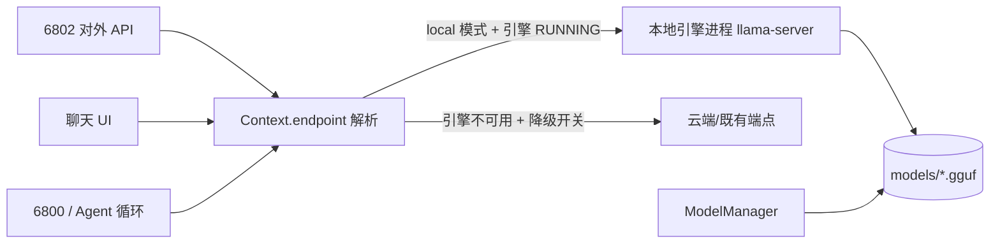

# 奇点 Windows Agent（qd-agent-win）
> 与《奇点Linux发行版_AI本地Agent调用文档 v1.9》对齐的 Windows 侧 Agent + 内置浏览器
> 原则沿用奇点 OS：**底座钉死、外围做活、token 最小化**

## 1. 与奇点 OS 的对齐表

| 奇点 Linux（ai_service） | Windows Agent（本项目） | 对齐方式 |
| --- | --- | --- |
| 6800 裸文本行对话入口 | 6800 同语义（STATUS/HELLO/ECHO/HELP/SKILLS/CHAT/BROWSER） | 协议逐字对齐，仅新增 BROWSER 指令族 |
| 6801 内部工具转发（总线起点） | 6801 JSON-lines 工具总线 | 同语义：所有工具调用走 6801 分发，不绕过 |
| 6802 OpenAI 兼容对外 API | 6802 同语义（/v1/models、/v1/chat/completions SSE） | 端点、错误码（400/401/502/504）、SSE 格式对齐 |
| 工具清单配置化 `tools=memo,task,skills` | 同名配置键 `tools=browser,memo,skills` | 未列出的工具不注入 schema、零 token |
| `tool_max_chars` 工具结果截断 | 同名键，默认 4000 | 一致 |
| PromptFragment system prompt 最小片段 | `prompts.py`：身份/能力/边界 三片段各 <50 token 按需拼 | 一致 |
| TurnFact 历史事实摘要压缩 | `history.py`：只回注 N 条事实，不回灌全量历史 | 一致（`history_facts_n`） |
| `.qdai` 配置/规范文件 | `配置.qdai`（键值格式一致） | 同名同格式 |
| 眼睛/笔/橡皮 授权工具 | Windows 无 uid 降权 → 用 **工具白名单 + 危险操作需用户确认** 模拟 | 授权唯一来源仍是用户 |
| 本地 LLM 规划（llama.cpp / MiniCPM） | `llm_mode=cloud|local`，local 指向任意 OpenAI 兼容端点 | 调度原则一致：用一个调一个，不用不调 |

## 2. 内置浏览器：框架选型（已定稿）

| 方案 | 内核 | 结论 |
| --- | --- | --- |
| **WebView2** | Chromium（Windows 系统自带） | **Windows 端选定**：零捆绑、原生嵌入、JS 桥可控 |
| CEF | Chromium | 体积 100MB+、编译复杂，过重 |
| QtWebEngine | Chromium | **Linux 端未来首选**（与 qdgt 桌面同栈） |
| Ultralight / Servo | 自研 | 兼容性差，页面识别不可靠，不采用 |

### 2.1 两边大差不差的关键：协议对齐，而非引擎一致

定义**浏览器文本协议**（`agent/browser/protocol.py`），AI 与浏览器之间只说这套协议：

```
NAVIGATE <url>          导航
SNAPSHOT [max_chars]    页面文本快照（标题/URL/可交互元素编号表/正文摘要）
CLICK <i>               点击第 i 号元素
TYPE <i> <文本>         向第 i 号输入框填入文本
SCROLL <down|up|top|bottom>
BACK / FORWARD / RELOAD
READ [max_chars]        只取正文纯文本（不取元素表，最省 token）
```

- Windows 端：`webview2.py` 适配器（pywebview + WebView2 + evaluate_js 桥）
- Linux 端（未开发）：用 QtWebEngine 的 `runJavaScript` 实现同一协议即可，ai_service 侧零改动
- **省 token 设计**：快照永远走「可交互元素编号表 + 正文摘要」，不发 HTML、不截图；
  SNAPSHOT 结果受 `snapshot_max_chars` 截断；READ 模式最省。

## 3. 运行

```sh
pip install -r requirements.txt   # pywebview 为浏览器必需；不装则浏览器降级为"未启用"
python -m agent.main              # 启动三端口，浏览器窗口一并拉起
python -m agent.app               # 桌面应用形态（聊天 UI + 三端口后台常驻）
```

冒烟（另开终端）：
```sh
nc 127.0.0.1 6800     → STATUS / HELLO / BROWSER SNAPSHOT
curl 127.0.0.1:6802/v1/models
```

## 3.1 Agent 循环（工具调用）

从 v2 起，本项目**具备自主工具调用能力**：模型可自行决定调用哪个工具、带什么参数，
拿到结果后再决定下一步，直到给出最终答复。

```
用户 → [system + 事实摘要] → 模型
                              │ tool_calls / [[TOOL: ...]]
                              ↓
                       ToolBus.execute（统一出口）
                              ↓
                       工具结果回灌为 tool 消息
                              ↓
                              └──→ 循环（≤ agent_max_rounds 轮）
```

**两条协议，自动降级**

| 模式 | 触发条件 | 说明 |
| --- | --- | --- |
| 原生 function calling | 上游接受 `tools` 参数**且真的返回 tool_calls** | 传 `tools=[...]`，解析 `delta.tool_calls` |
| 文本协议兜底 | 上游返回 4xx 拒绝 tools，或模型不产 tool_calls | 正文里写 `[[TOOL: browser {"cmd":"SNAPSHOT"}]]` |

降级是**自动**的：原生失败后注入协议说明 + few-shot 示例并以文本协议重试，不丢用户请求。
若上游连 `tools` 都不认识，文本协议仍可工作——这对手机端小模型（MNN 等）尤其重要。

> **重要**：部分小模型服务**接受 `tools` 参数但从不返回 `tool_calls`**（把它当普通字段忽略）。
> 这类模型必须用 `agent_tool_mode=text` 强制走文本协议。
> 用 `python probe_text_protocol.py` 可实测当前模型的工具调用能力。

**关键实现**

- `agent/loop.py`：多轮循环。工具执行一律走 `ToolBus`，与 6801 外部调用**共用同一出口**，不绕过总线。
- `agent/tools.py`：`openai_schemas()` 只导出已注册工具的 schema（未列入 `tools=` 的一个 token 都不花）；`invoke()` 供循环内部直调。
- `agent/llm.py`：`chat_stream_events()` 把 SSE 流聚合成事件流，同时支持文本增量与 `tool_calls` 增量累积。
- 工具结果回灌前按 `agent_max_tool_result` 截断；单次任务受 `agent_max_rounds` / `agent_max_seconds` 双保护。
- 模型"只说不做"（声称要调工具却没调）会被识别并提示，不静默通过。
- **错误分类**：仅 HTTP 4xx 才判定为"上游拒绝 tools"并降级；网络超时/5xx 直接报错——
  避免手机休眠导致的超时被误判成能力缺失。
- **事件分级**：`notice`（非致命，如降级提示，界面显示灰色提示条）vs `error`（致命）。
  降级提示走 notice，不会中断后续输出。
- **能力缓存**：按 (base, model) 记住该端点是否支持原生 tools，避免每轮对话都先撞一次墙。

**配置**（`配置.qdai`）

```
agent_enabled=on           # off=退回原来的一问一答
agent_tool_mode=text       # text=只用文本协议 / native=只用原生 / auto=先原生后降级
agent_max_rounds=6         # 单次任务最多几轮模型请求
agent_max_seconds=180      # 单次任务总时长上限
agent_req_timeout=90       # 单次模型请求超时（秒）
agent_text_fallback=on     # 上游拒绝原生 tools 时启用文本协议
agent_max_tool_result=1500 # 单次工具结果回灌上限
agent_confirm_tools=       # 需用户确认的工具（当前界面无交互确认，留空）
```

> `agent_enabled=off` 时行为与 v1 完全一致：单次请求、不调工具。用于对照排查。

## 3.2 工具清单（v3 起补齐 Agent 核心能力）

| 工具 | 能力 | 关键 op / 参数 |
| --- | --- | --- |
| **fs** | 读取本机文件与目录（默认只读） | `list` 树形列目录 · `read` 读文本 · `search` 按名递归查 · `grep` 按内容递归查 · `info` 大小/时间 |
| **code** | 本机代码执行 | `lang=python` 跑 Python · `lang=shell` 跑 cmd；超时保护 + 输出截断 |
| **screen** | 屏幕操控（纯 ctypes，零第三方依赖） | `shot` 全屏截图存 PNG · `key` 组合键（`win+d`）· `type` 输入文本（中文走 Unicode 键事件）· `click`/`move` 坐标 |
| **browser** | 内置浏览器 | NAVIGATE / SNAPSHOT / CLICK / TYPE / SCROLL / READ |
| **memo** | 长期记忆 | `op=write` 记一条 · `op=search` 按关键词检索 |
| **skills** | 技能列表 | 扫描 `skills/` 目录 |
| **phone** | 手机侧执行 | 把任务交给手机上的奇点 OS 智能体 |

`tools=fs,code,screen,browser,memo,skills,phone` —— 未列出的工具不注入 schema、不暴露，**零未用工具 token**。

**安全边界**
- `fs` 默认**只读**；路径支持 `~` 与相对路径（相对项目根解析）；`list` 深度上限 4、条目上限 200，`grep` 跳过 >2MB 文件
- `code` 有 `code_timeout` 超时（默认 60s，上限 300s）与 `code_max_chars` 输出截断
- `screen` 坐标越界直接拒绝，不会误点；按键白名单外的不识别
- 截图存到 `shots/` 目录，模型拿到的是**路径与屏幕尺寸**，不是图片本体

**上下文与记忆（三层）**
1. **facts 事实表**（`history.py`）：每轮压缩成摘要，按**句子边界**截断（非硬切），只回注最近 `history_facts_n` 条
2. **会话文件**（`会话/<id>.json`）：`messages` 全量 + `facts` 快照，切会话时恢复
3. **长期记忆**（`记忆.txt`）：`memo` 工具读写，模型可自主调用——这是唯一能跨会话留存的部分

## 6. 内置本地推理模型（形态对齐手机端：模型在推理引擎里跑 + 对外 OpenAI 兼容 API）

手机端是「proot 容器 + llama.cpp/MNN 原生引擎 + GGUF 模型 + 本地 HTTP API」。
Windows 侧对标实现：**托管 llama-server 子进程**（`agent/local_engine.py`）+ **模型管理器**
（`agent/model_mgr.py`），模型在引擎进程里跑，Agent 内部与**对外 API（6802）**都通过同一个
OpenAI 兼容端点访问它。



```
  状态：stopped → starting（退避+抖动轮询健康）→ running
                     ↓ 超时/闪退
                   failed（带可枚举原因，不静默失败）
```

**三条硬约束（已实装）**：就绪等待上限 90s（超时一律失败并给原因）、健康检查指数退避+抖动、
停止先 TERM 超时再 KILL。**不存在无上限等待或 `while True` 重试。**

**快速开始（三步）**

```sh
# 1. 放引擎二进制：下载 llama.cpp Windows CPU 发行包，解压后把 llama-server.exe 路径
#    填进 配置.qdai 的 local_engine_binary（本机无独显，务必不要设 n-gpu-layers）
# 2. 放模型：把 GGUF 放进 models/<模型名>/
python -u -m agent.model_mgr scan                 # 看看识别到几个模型、各自要多大内存
python -u -m agent.model_mgr recommend 11.8       # 按本机内存推荐：预算内的最大可用模型
# 3. 启动并对外服务
#    界面方式：聊天窗左下角设定后可随应用自启（local_engine_autostart=on）
#    或 llm_mode=local 后：外部程序直接打 http://127.0.0.1:6802/v1/chat/completions
```

> **本机硬件实测**：Intel Celeron N5095A（4 核 @2.0GHz）、无 NVIDIA 独显（Intel UHD）、物理内存 11.8GB。
> 结论：只能纯 CPU 推理，建议 **1.5B~3B 的 Q4 量化 GGUF**（约 1~2GB 占用）；
> 7B 及以上会明显卡顿。实际 token 吞吐以你跑起来后的日志为准，
> 仓库不提供未经实测的性能数字。

**安全**：删除模型不可逆，`ModelManager.delete()` 未提供 `confirm=True` 时**一律拒绝执行**；
UI 接入时须弹二次确认并要求用户输入模型 id 复核。

**测试**：`python -u test_local_engine.py`（22 项：进程启停、健康退避轮询、就绪超时、进程闪退、
参数拼装、模型扫描/推荐/删除确认）、`python -u test_local_api_e2e.py`（7 项：外部打 6802 的真实答复由本地引擎产生）。

## 4. 目录

```
qd-agent-win/
├─ 配置.qdai              # 配置（键与 ai_service 对齐 + browser 组 + agent 组）
├─ requirements.txt
├─ skills/                # skills 仓库区（同 ai.qd/skills 语义）
├─ test_agent_loop.py     # agent 循环单元测试（mock 上游）
├─ test_e2e_ports.py      # 三端口集成测试
├─ test_app_path.py       # 桌面 UI 路径集成测试
├─ test_new_tools.py      # fs/code/screen 新工具测试
├─ test_intent.py         # 三层意图解析专项测试
├─ test_intent_e2e.py     # 4B 风格输出端到端（【文件列表】触发工具）
├─ test_pc_bridge.py      # 电脑文件桥全接口 + 安全模型测试
├─ probe_text_protocol.py # 实测当前模型能否输出 [[TOOL:]] 工具调用
├─ 模型能力实测报告.md    # 手机端模型能力实测结论
└─ agent/
   ├─ main.py             # 入口：装配三端口 + 浏览器
   ├─ app.py              # 桌面应用壳（聊天 UI + 后台三端口 + 文件桥）
   ├─ config.py           # .qdai 配置加载
   ├─ prompts.py          # PromptFragment 最小片段注入
   ├─ history.py          # TurnFact 历史压缩（句子边界截断）
   ├─ llm.py              # OpenAI 兼容客户端（云端/本地分流 + 工具调用事件流）
   ├─ loop.py             # Agent 循环（工具调用 + 文本协议兜底 + few-shot）
   ├─ intent.py           # 三层意图解析（标准协议/变体标记/自然语言）
   ├─ tools.py            # 工具注册表（fs/code/screen/browser/memo/skills/phone）
   ├─ screen_ctl.py       # 屏幕截图与键鼠操控（纯 ctypes）
   ├─ pc_bridge.py        # 电脑文件桥（手机 qidian编辑器 无线读写本机文件）
   ├─ servers.py          # 6800 / 6801 / 6802
   └─ browser/
      ├─ protocol.py      # 浏览器文本协议（引擎无关）
      └─ webview2.py      # WebView2 适配器
```

> **安全边界**（对齐 §3.2 双域权限模型）：三端口一律只绑 127.0.0.1；6802 对外监听需显式改
> `http_host` 并强制 Bearer 校验。`fs` 默认**只读**，写盘类工具一律不注册；
> `code` 有超时与输出截断；`screen` 坐标越界拒绝。授权唯一来源仍是用户——
> 所有能力经工具白名单收窄，不依赖 uid 降权（Windows 无此机制）。

## 5. 电脑文件桥（手机 qidian编辑器 ⇄ 本机，v4 新增）

从手机端 Node 版 `pc_bridge` 移植的**原生 Python 模块**（`agent/pc_bridge.py`，纯标准库）。
手机上的 **qidian编辑器** 在同一局域网内即可：浏览本机所有盘符目录、打开文本文件编辑、
**修改后一键写回电脑**、新建/删除、二进制上传下载。

```
界面启动：侧栏「📱 电脑文件桥」→ 看地址与连接码 → 点「启动」
命令行：  python -m agent.pc_bridge [--port 8899] [--root D:\代码]
自启：    配置.qdai 里 pc_bridge_enabled=on
手机端：  qidian编辑器 → 设置 → 💻 电脑连接 → 填入弹窗里的 IP 和连接码
```

- **API 与 Node 版逐条一致**（`/api/ping|list|read|write|mkdir|delete|download|upload`），手机端零改动
- **安全模型不变**：连接码（32 位 hex，存 `pc_bridge.token`，删了重启换新码）+ 全部接口鉴权；
  可选 `--root`/`pc_bridge_root` 把访问范围锁死在某个目录树；关 Agent 窗口即停服务
- 监听 `0.0.0.0:8899`（局域网），CORS 放开给手机 WebView；首次运行 Windows 防火墙弹窗点**允许**
- 测试：`python -u test_pc_bridge.py`（18 项：全接口 + token 拒绝 + root 越界拒绝）
