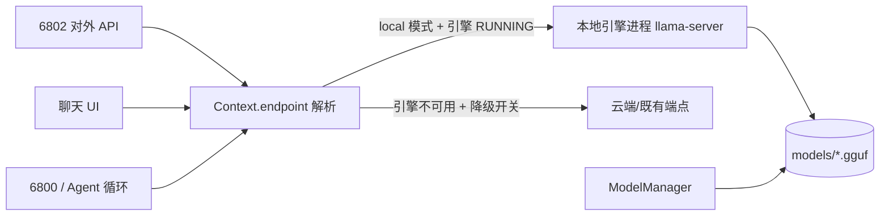

# 奇点 Windows Agent（qd-agent-win）
> 与《奇点Linux发行版_AI本地Agent调用文档 v1.9》对齐的 Windows 侧 Agent + 内置浏览器
> 原则沿用奇点 OS：**底座钉死、外围做活、token 最小化**

## 1. 与奇点 OS 的对齐表

| 奇点 Linux（ai_service） | Windows Agent（本项目） | 对齐方式 |
| --- | --- | --- |
| 6800 裸文本行对话入口 | 6800 同语义（STATUS/HELLO/ECHO/HELP/SKILLS/CHAT/BROWSER） | 协议逐字对齐，仅新增 BROWSER 指令族 |
| 6801 内部工具转发（总线起点） | 6801 JSON-lines 工具总线 | 同语义：所有工具调用走 6801 分发，不绕过 |
| 6802 OpenAI 兼容对外 API | 6802 同语义（/v1/models、/v1/chat/completions SSE） | 端点、错误码（400/401/502/504）、SSE 格式对齐 |
| 工具清单配置化 `tools=memo,task,skills` | 同名配置键 `tools=browser,memo,skills` | 未列出的工具不注入 schema、零 token |
| `tool_max_chars` 工具结果截断 | 同名键，默认 4000 | 一致 |
| PromptFragment system prompt 最小片段 | `prompts.py`：身份/能力/边界 三片段各 <50 token 按需拼 | 一致 |
| TurnFact 历史事实摘要压缩 | `history.py`：只回注 N 条事实，不回灌全量历史 | 一致（`history_facts_n`） |
| `.qdai` 配置/规范文件 | `配置.qdai`（键值格式一致） | 同名同格式 |
| 眼睛/笔/橡皮 授权工具 | Windows 无 uid 降权 → 用 **工具白名单 + 危险操作需用户确认** 模拟 | 授权唯一来源仍是用户 |
| 本地 LLM 规划（llama.cpp / MiniCPM） | `llm_mode=cloud|local`，local 指向任意 OpenAI 兼容端点 | 调度原则一致：用一个调一个，不用不调 |

## 2. 内置浏览器：框架选型（已定稿）

| 方案 | 内核 | 结论 |
| --- | --- | --- |
| **WebView2** | Chromium（Windows 系统自带） | **Windows 端选定**：零捆绑、原生嵌入、JS 桥可控 |
| CEF | Chromium | 体积 100MB+、编译复杂，过重 |
| QtWebEngine | Chromium | **Linux 端未来首选**（与 qdgt 桌面同栈） |
| Ultralight / Servo | 自研 | 兼容性差，页面识别不可靠，不采用 |

### 2.1 两边大差不差的关键：协议对齐，而非引擎一致

定义**浏览器文本协议**（`agent/browser/protocol.py`），AI 与浏览器之间只说这套协议：

```
NAVIGATE <url>          导航
SNAPSHOT [max_chars]    页面文本快照（标题/URL/可交互元素编号表/正文摘要）
CLICK <i>               点击第 i 号元素
TYPE <i> <文本>         向第 i 号输入框填入文本
SCROLL <down|up|top|bottom>
BACK / FORWARD / RELOAD
READ [max_chars]        只取正文纯文本（不取元素表，最省 token）
```

- Windows 端：`webview2.py` 适配器（pywebview + WebView2 + evaluate_js 桥）
- Linux 端（未开发）：用 QtWebEngine 的 `runJavaScript` 实现同一协议即可，ai_service 侧零改动
- **省 token 设计**：快照永远走「可交互元素编号表 + 正文摘要」，不发 HTML、不截图；
  SNAPSHOT 结果受 `snapshot_max_chars` 截断；READ 模式最省。

## 3. 运行

### 3.0 部署到 GitHub 与新机启动（含安全前置）

> **必须先做**：`配置.qdai` 里有你的 `api_key`（以及 `profiles` 里各档位的 key），
> 该文件**已在 .gitignore 中被忽略**，仓库只提供脱敏模板 `配置.example.qdai`。
> 推送前请确认 `git status` 里**不出现** `配置.qdai` / `pc_bridge.token`；
> 一旦误推，立刻去服务商吊销该 key（GitHub 上的历史提交删不干净）。

第一次推送：

```sh
git init
git remote add origin https://github.com/<你的账号>/<仓库名>.git
git add .
git status                 # 逐个确认：配置.qdai、pc_bridge.token、kb/、memories/、shots/ 都不应在列表里
git commit -m "init"
git push -u origin main
```

> **仓库内置 `.gitattributes`**：`.bat`/`.cmd`/`.ps1` 检出为 CRLF（Windows 必需），
> `.sh`/`.py`/`.json` 等保持 LF（否则 shell 脚本报 `bad interpreter: /bin/sh^M`）。
> 这是跨平台 clone 能跑起来的关键，别删。

换一台机器从零跑起来：

```sh
git clone https://github.com/<你的账号>/<仓库名>.git
cd <仓库名>

pip install -r requirements.txt        # 唯一第三方依赖：pywebview（GUI 必需）

# 复制脱敏模板并填入你自己的 key（缺这一步也能启动，但会弹设置框且云端模型不可用）
cp 配置.example.qdai 配置.qdai
#   用编辑器打开 配置.qdai，填 api_key=sk-... ；有手机网关就再填 profiles 里的 key

python -m agent.app                    # 启动图形界面
```

图形界面起不来的常见原因：

| 现象 | 原因与处理 |
|---|---|
| 报 `ModuleNotFoundError: webview` | 没装依赖：`pip install -r requirements.txt` |
| 窗口一闪而过 | 缺 **WebView2 Runtime**（Win11 一般自带；Win10 需装 Microsoft Edge WebView2 Runtime） |
| 能起但浏览器工具未启用 | 同上，装 WebView2 后重启 |
| 提示未配置 | `配置.qdai` 缺失或 `api_key` 为空；复制模板并填 key |

> 直接用 `start.bat` 也可以：它会优先找本机 Python，找不到才退回 `python`，
> 所以新机只要 `python` 在 PATH 里、且在项目根目录双击即可。

```sh
python -m agent.main              # 只起三端口（无 GUI），用于服务器/无头场景
python -m agent.app               # 桌面应用形态（聊天 UI + 三端口后台常驻）
```

冒烟（另开终端）：
```sh
nc 127.0.0.1 6800     → STATUS / HELLO / BROWSER SNAPSHOT
curl 127.0.0.1:6802/v1/models
```

## 3.1 Agent 循环（工具调用）

从 v2 起，本项目**具备自主工具调用能力**：模型可自行决定调用哪个工具、带什么参数，
拿到结果后再决定下一步，直到给出最终答复。

```
用户 → [system + 事实摘要] → 模型
                              │ tool_calls / [[TOOL: ...]]
                              ↓
                       ToolBus.execute（统一出口）
                              ↓
                       工具结果回灌为 tool 消息
                              ↓
                              └──→ 循环（≤ agent_max_rounds 轮）
```

**两条协议，自动降级**

| 模式 | 触发条件 | 说明 |
| --- | --- | --- |
| 原生 function calling | 上游接受 `tools` 参数**且真的返回 tool_calls** | 传 `tools=[...]`，解析 `delta.tool_calls` |
| 文本协议兜底 | 上游返回 4xx 拒绝 tools，或模型不产 tool_calls | 正文里写 `[[TOOL: browser {"cmd":"SNAPSHOT"}]]` |

降级是**自动**的：原生失败后注入协议说明 + few-shot 示例并以文本协议重试，不丢用户请求。
若上游连 `tools` 都不认识，文本协议仍可工作——这对手机端小模型（MNN 等）尤其重要。

> **重要**：部分小模型服务**接受 `tools` 参数但从不返回 `tool_calls`**（把它当普通字段忽略）。
> 这类模型必须用 `agent_tool_mode=text` 强制走文本协议。
> 用 `python probe_text_protocol.py` 可实测当前模型的工具调用能力。

**关键实现**

- `agent/loop.py`：多轮循环。工具执行一律走 `ToolBus`，与 6801 外部调用**共用同一出口**，不绕过总线。
- `agent/tools.py`：`openai_schemas()` 只导出已注册工具的 schema（未列入 `tools=` 的一个 token 都不花）；`invoke()` 供循环内部直调。
- `agent/llm.py`：`chat_stream_events()` 把 SSE 流聚合成事件流，同时支持文本增量与 `tool_calls` 增量累积。
- 工具结果回灌前按 `agent_max_tool_result` 截断；单次任务受 `agent_max_rounds` / `agent_max_seconds` 双保护
- 每轮上报 token 用量，界面底部上下文条实时显示已用/预算；`agent_max_seconds=0` 时超时长任务只软提醒、不强杀
- 设置面板支持**多模型档案**：云端/本地多套端点配置各自保存、一键切换，写入 `配置.qdai` 重启不丢失
- 模型"只说不做"（声称要调工具却没调）会被识别并提示，不静默通过。
- **错误分类**：仅 HTTP 4xx 才判定为"上游拒绝 tools"并降级；网络超时/5xx 直接报错——
  避免手机休眠导致的超时被误判成能力缺失。
- **事件分级**：`notice`（非致命，如降级提示，界面显示灰色提示条）vs `error`（致命）。
  降级提示走 notice，不会中断后续输出。
- **能力缓存**：按 (base, model) 记住该端点是否支持原生 tools，避免每轮对话都先撞一次墙。

**配置**（`配置.qdai`）

```
agent_enabled=on           # off=退回原来的一问一答
agent_tool_mode=text       # text=只用文本协议 / native=只用原生 / auto=先原生后降级
agent_max_rounds=6         # 单次任务最多几轮模型请求
agent_max_seconds=180      # 单次任务总时长上限
agent_req_timeout=90       # 单次模型请求超时（秒）
agent_text_fallback=on     # 上游拒绝原生 tools 时启用文本协议
agent_max_tool_result=1500 # 单次工具结果回灌上限
agent_confirm_tools=       # 需用户确认的工具（当前界面无交互确认，留空）
```

> `agent_enabled=off` 时行为与 v1 完全一致：单次请求、不调工具。用于对照排查。

## 3.2 工具清单（v3 起补齐 Agent 核心能力）

| 工具 | 能力 | 关键 op / 参数 |
| --- | --- | --- |
| **fs** | 读取本机文件与目录（默认只读） | `list` 树形列目录 · `read` 读文本 · `search` 按名递归查 · `grep` 按内容递归查 · `info` 大小/时间 |
| **code** | 本机代码执行 | `lang=python` 跑 Python · `lang=shell` 跑 cmd；超时保护 + 输出截断 |
| **screen** | 屏幕操控（纯 ctypes，零第三方依赖） | `shot` 全屏截图存 PNG · `key` 组合键（`win+d`）· `type` 输入文本（中文走 Unicode 键事件）· `click`/`move` 坐标 |
| **browser** | 内置浏览器 | NAVIGATE / SNAPSHOT / CLICK / TYPE / SCROLL / READ |
| **memo** | 长期记忆 | `op=write` 记一条 · `op=search` 按关键词检索 |
| **skills** | 技能列表 | 扫描 `skills/` 目录 |
| **phone** | 手机侧执行 | 把任务交给手机上的奇点 OS 智能体 |
| **spawn** | 分裂子 Agent | `task` 子任务描述 · `tools` 子 Agent 可用工具（默认同主子 Agent）；深度上限 1 层，结论截断回灌 |

`tools=spawn,fs,code,screen,browser,memo,skills,phone` —— 未列出的工具不注入 schema、不暴露，**零未用工具 token**。

**安全边界**
- `fs` 默认**只读**；路径支持 `~` 与相对路径（相对项目根解析）；`list` 深度上限 4、条目上限 200，`grep` 跳过 >2MB 文件
- `code` 有 `code_timeout` 超时（默认 60s，上限 300s）与 `code_max_chars` 输出截断
- `screen` 坐标越界直接拒绝，不会误点；按键白名单外的不识别
- 截图存到 `shots/` 目录，模型拿到的是**路径与屏幕尺寸**，不是图片本体

**上下文与记忆（三层）**
1. **facts 事实表**（`history.py`）：每轮压缩成摘要，按**句子边界**截断（非硬切），只回注最近 `history_facts_n` 条
2. **会话文件**（`会话/<id>.json`）：`messages` 全量 + `facts` 快照，切会话时恢复
3. **长期记忆**（`记忆.txt`）：`memo` 工具读写，模型可自主调用——这是唯一能跨会话留存的部分

## 6. 内置本地推理模型（形态对齐手机端：模型在推理引擎里跑 + 对外 OpenAI 兼容 API）

手机端是「proot 容器 + llama.cpp/MNN 原生引擎 + GGUF 模型 + 本地 HTTP API」。
Windows 侧对标实现：**托管 llama-server 子进程**（`agent/local_engine.py`）+ **模型管理器**
（`agent/model_mgr.py`），模型在引擎进程里跑，Agent 内部与**对外 API（6802）**都通过同一个
OpenAI 兼容端点访问它。



```
  状态：stopped → starting（退避+抖动轮询健康）→ running
                     ↓ 超时/闪退
                   failed（带可枚举原因，不静默失败）
```

**三条硬约束（已实装）**：就绪等待上限 90s（超时一律失败并给原因）、健康检查指数退避+抖动、
停止先 TERM 超时再 KILL。**不存在无上限等待或 `while True` 重试。**

**快速开始（三步）**

```sh
# 1. 放引擎二进制：下载 llama.cpp Windows CPU 发行包，解压后把 llama-server.exe 路径
#    填进 配置.qdai 的 local_engine_binary（本机无独显，务必不要设 n-gpu-layers）
# 2. 放模型：把 GGUF 放进 models/<模型名>/
python -u -m agent.model_mgr scan                 # 看看识别到几个模型、各自要多大内存
python -u -m agent.model_mgr recommend 11.8       # 按本机内存推荐：预算内的最大可用模型
# 3. 启动并对外服务
#    界面方式：聊天窗左下角设定后可随应用自启（local_engine_autostart=on）
#    或 llm_mode=local 后：外部程序直接打 http://127.0.0.1:6802/v1/chat/completions
```

> **本机硬件实测**：Intel Celeron N5095A（4 核 @2.0GHz）、无 NVIDIA 独显（Intel UHD）、物理内存 11.8GB。
> 结论：只能纯 CPU 推理，建议 **1.5B~3B 的 Q4 量化 GGUF**（约 1~2GB 占用）；
> 7B 及以上会明显卡顿。实际 token 吞吐以你跑起来后的日志为准，
> 仓库不提供未经实测的性能数字。

**安全**：删除模型不可逆，`ModelManager.delete()` 未提供 `confirm=True` 时**一律拒绝执行**；
UI 接入时须弹二次确认并要求用户输入模型 id 复核。

**测试**：`python -u test_local_engine.py`（22 项：进程启停、健康退避轮询、就绪超时、进程闪退、
参数拼装、模型扫描/推荐/删除确认）、`python -u test_local_api_e2e.py`（7 项：外部打 6802 的真实答复由本地引擎产生）。

## 4. 目录

```
qd-agent-win/
├─ start.bat               # 双击启动（自动定位 Python）
├─ kill_old.ps1            # 清残留进程（start.bat 调用，避免端口占用）
├─ 配置.qdai               # 配置（键与 ai_service 对齐 + browser 组 + agent 组）
├─ 配置.example.qdai       # 脱敏配置模板（clone 后复制成 配置.qdai 再填 key）
├─ requirements.txt        # 唯一第三方依赖：pywebview
├─ phone_gateway.py        # 手机网关（手机 AI ⇄ 本机 Agent 桥接）
├─ README.md               # 完整架构文档（本文件）
├─ agent/                  # 全部源码
│  ├─ main.py              # 入口：装配三端口 + 浏览器
│  ├─ app.py               # 桌面应用壳（聊天 UI + 后台三端口 + 文件桥 + 知识库 + 记忆 + 市场）
│  ├─ config.py            # .qdai 配置加载（含模型容量查表 + 区域外观参数）
│  ├─ prompts.py           # PromptFragment 最小片段注入
│  ├─ history.py           # TurnFact 历史压缩（句子边界截断）
│  ├─ llm.py               # OpenAI 兼容客户端（云端/本地分流 + 工具调用事件流）
│  ├─ loop.py              # Agent 循环（工具调用 + 文本协议兜底 + 上下文主动压缩）
│  ├─ intent.py            # 三层意图解析（标准协议/变体标记/自然语言 + skill 硬触发）
│  ├─ tools.py             # 工具注册表（fs/code/screen/browser/memo/skills/phone/spawn/kb）
│  ├─ econ.py              # 经济性：token 估算 + 头尾保留截断（对齐 pi 的省钱手段）
│  ├─ kb.py                # 知识库：文件名索引 + 正文内容索引（分块/倒排检索）
│  ├─ memory.py            # 长期记忆：跨会话结构化条目（自动捕获/去重/按需召回）
│  ├─ market.py            # 市场：技能/插件货架（安装/启停/卸载/URL 安装）
│  ├─ voice.py             # 语音转文字（Windows System.Speech， PowerShell 通道）
│  ├─ screen_ctl.py        # 屏幕截图与键鼠操控（纯 ctypes）
│  ├─ pc_bridge.py         # 电脑文件桥（手机 qidian编辑器 无线读写本机文件 + /kb 检索）
│  ├─ local_engine.py      # 内置本地推理引擎（llama-server 子进程托管）
│  ├─ model_mgr.py         # 本地模型管理（扫描/推荐/激活）
│  ├─ servers.py           # 6800 / 6801 / 6802
│  └─ browser/
│     ├─ protocol.py       # 浏览器文本协议（引擎无关）
│     └─ webview2.py       # WebView2 适配器
├─ ui/index.html           # 桌面界面（背景/玻璃/输入框/上下文环/模型切换/市场/记忆面板）
├─ ui/bg.json              # 已保存的背景图（base64）
├─ skills/                 # skills 仓库区（*.qdskill，声明式 + trigger/run 头）
├─ plugins/                # 插件目录（*.qdplugin，声明式命令；禁用加 .disabled 后缀）
├─ market/store/           # 市场货架（rea/docgen 技能、sysinfo 插件）
├─ tests/                  # 13 个测试套件（tools/构建检查.py 一键全跑）
├─ tools/                  # 诊断脚本（网关/延迟/端口/镜像 mock）+ 构建检查.py
├─ docs/                   # 快速开始 / 模型能力实测报告
├─ models/                 # 本地 GGUF 模型存放（.gitkeep 占位）
├─ memories/               # 长期记忆持久化（运行时生成，不入库）
├─ kb/                     # 知识库索引（运行时生成，不入库）
└─ 会话/                   # 会话持久化（运行时生成，不入库）
```

> **安全边界**（对齐 §3.2 双域权限模型）：三端口一律只绑 127.0.0.1；6802 对外监听需显式改
> `http_host` 并强制 Bearer 校验。`fs` 默认**只读**，写盘类工具一律不注册；
> `code` 有超时与输出截断；`screen` 坐标越界拒绝。授权唯一来源仍是用户——
> 所有能力经工具白名单收窄，不依赖 uid 降权（Windows 无此机制）。

## 5. 电脑文件桥（手机 qidian编辑器 ⇄ 本机，v4 新增）

从手机端 Node 版 `pc_bridge` 移植的**原生 Python 模块**（`agent/pc_bridge.py`，纯标准库）。
手机上的 **qidian编辑器** 在同一局域网内即可：浏览本机所有盘符目录、打开文本文件编辑、
**修改后一键写回电脑**、新建/删除、二进制上传下载。

```
界面启动：侧栏「📱 电脑文件桥」→ 看地址与连接码 → 点「启动」
命令行：  python -m agent.pc_bridge [--port 8899] [--root D:\代码]
自启：    配置.qdai 里 pc_bridge_enabled=on
手机端：  qidian编辑器 → 设置 → 💻 电脑连接 → 填入弹窗里的 IP 和连接码
```

- **API 与 Node 版逐条一致**（`/api/ping|list|read|write|mkdir|delete|download|upload`），手机端零改动
- **安全模型不变**：连接码（32 位 hex，存 `pc_bridge.token`，删了重启换新码）+ 全部接口鉴权；
  可选 `--root`/`pc_bridge_root` 把访问范围锁死在某个目录树；关 Agent 窗口即停服务
- 监听 `0.0.0.0:8899`（局域网），CORS 放开给手机 WebView；首次运行 Windows 防火墙弹窗点**允许**
- 测试：`python -u test_pc_bridge.py`（18 项：全接口 + token 拒绝 + root 越界拒绝）
- **知识库接口**（v5）：`/kb/stats` 看索引状态、`/kb/search?kw=关键词` 按文件名检索——
  手机端与 PC 端 Agent 共用同一份全机文件索引

## 6. 上下文经济性：像 pi 一样省 token（v5 新增）

对标 GitHub 上的 **pi（earendil-works/pi，原 badlogic/pi-mono）**——它以极小系统提示、
工具输出硬截断、上下文预算管理把消耗压到极低。本项目落地了同样思路（`agent/econ.py`）：

| pi 的做法 | 本项目实现 |
|---|---|
| 一句话系统提示 + 每工具一行说明 | `prompts.py` 按已启用工具最小拼接，追加"先结论后细节"的简洁风格约束 |
| 工具输出 2000 行/50KB 封顶 + "用 offset 续读" | `econ.truncate_middle/truncate_head`；`fs read` 默认 300 行，超限给可操作的 `offset=` 续读行号 |
| 上下文到「窗口-16384」就压缩，保留最近约 2 万 token | `loop.py` 每轮前估算 token，用掉 `agent_compact_ratio`（默认 80%）即**主动压缩**：保系统提示+首轮任务+当前整轮，中段免费折叠成本地摘要 |
| 报错多在输出末尾 | 工具结果**头尾保留、中间打洞**，退出码/报错永不丢 |

配置项（`配置.qdai`）：`agent_compact_ratio=0.8`（主动压缩阈值，0=关）、
`agent_keep_tokens=8000`、`agent_max_tool_result`（单条工具结果截断字符数）。

## 7. 知识库 + 记忆 + 语音 + 模型自动入库（v5 新增）

- **知识库**（`agent/kb.py`）：**两层索引**。
  - *文件名层*：首次启动**后台扫描**电脑常用目录（桌面/文档/下载/图片/各盘顶层），
    只记路径/名字/大小/时间，不读内容——秒级完成、隐私可控。Agent 用 `kb` 工具按文件名秒查路径，
    比翻目录列表省 90% token；索引超 24 小时自动重建。
  - *正文层*：文档按段落切块（600 字/重叠 80）建倒排索引（中文 2-gram），
    支持「搜正文」——Agent 能回答"我这份文件里写了什么"，不再只报路径。
  - 手机端经文件桥 `/kb/search`、`/kb/stats` **共用同一份索引**。
- **长期记忆**（`agent/memory.py`，`memories/memory.json`）：跨会话结构化记忆，
  分**档案 / 偏好 / 事实 / 待办**四类，带标签与命中次数。
  - *自动捕获*：对话中出现"记住…""我喜欢…""我叫…"时自动入库，闲聊不会乱存；
  - *去重合并*：相似度 ≥72% 视为同一条，不会重复堆积；
  - *按需召回*：每轮只把**与本次提问相关**的记忆回注给模型（问"我的名字"能命中，
    问"明天天气"一条都不注入）——省 token 且不打扰。
- **记忆查看**：侧栏「记忆 · 知识库」面板统一管理——搜索、手动增删、按类型看分布，
  知识库页可一键切换「搜文件名 ↔ 搜正文」、重建索引、导入文档。
- **模型库自动入库**：云端 API 配置填完整并保存 → 自动存成档案（`模型 @ 域名`），
  同名覆盖不重复；重启不丢（`load_config` 解析 `profiles`）。输入框右下角可即时切换。
- **语音转文字**（`agent/voice.py`）：走 Windows 自带语音识别（零第三方依赖）。
  说中文需系统装有中文语音包（设置 → 时间和语言 → 语音 → 添加中文）；
  无麦克风/无语音包时给出明确提示，不静默失败。

## 8. 市场 / Skills / 插件：可插拔能力层（v6 新增）

三套机制各司其职，**都不需要改源码**：

| 机制 | 形态 | 装上之后怎么用 |
|---|---|---|
| **Skill**（`skills/*.qdskill`） | 声明式文本（`name/version/desc` 头 + `trigger/action/run`） | 模型按语义自动触发；也可用输入框「＋」手动塞进提示词 |
| **插件**（`plugins/*.qdplugin`） | 声明式（描述要执行的命令，不加载 Python） | 注册为**模型可见的真工具**，遇到相关场景模型自动调用 |
| **市场**（`agent/market.py` + `market/store/`） | 应用内货架 | 浏览 / 安装 / 启用禁用 / 卸载 / URL 安装 |

- **市场**就是"装/卸"的地方，与"怎么调用"分离——插件装上就一直生效，不用每次进市场；
- **技能硬触发**：`agent/intent.py` 的 `_load_skill_rules()` 扫描 `skills/` 的 `trigger/run` 头，
  命中即派发对应动作（例："帮我打开工作台" → 直接拉起 `wb_start.cmd`）；
- **市场 URL 安装**：仅允许 http/https、体积 ≤2MB，路径穿越一律拦截；
- **禁用即摘除**：插件禁用后加 `.disabled` 后缀，工具从 schema 中消失，不占 token。

## 9. 界面：可换背景 + 玻璃 + 区域独立控制（v6 新增）

桌面界面（`ui/index.html`，单文件内联 CSS/JS，pywebview 直接加载磁盘路径、无 HTTP 缓存）：

- **可换背景**：支持预设与上传自有图片，`设置 → 个性化 → 背景图片` 实时预览窗
  **完整复刻真实渲染**（背景图 + 可见度罩层 + 玻璃样卡），所见即所得；
  **画面焦点可点选**（长图只看上半部分）、上下/左右滑块微调、"看顶/看中/看底"快捷按钮。
- **三档可调**：背景可见度（0–100%）、玻璃磨砂度（0–28px）、玻璃总开关。
- **任务栏与聊天区彻底解耦**：两区各有**独立玻璃开关 + 独立浓度滑块**
  （浓度 0% = 全透出背景图，100% = 完全不透明）；
  拧总开关不再牵连任何一区，深浅主题各有各的默认浓度，手动调过即锁定不被主题覆盖。
- **输入框（仿 WorkBuddy）**：底部内嵌**上下文圆环**（浅色 = 剩余可用 / 填充 = 已用，
  ≥90% 转红预警）、右下**模型即时切换**、最左**「＋」菜单**（添加文件 / 技能 / 插件），
  快捷键 **Ctrl/⌘+K** 开关「＋」菜单（Esc 关闭），Enter 发送、Shift+Enter 换行。
- **玻璃性能**：不走整窗 DWM 亚克力，改为背景层 + 局部 `backdrop-filter`，
  弹窗打开时全局关闭模糊，避免卡顿。

## 10. 启动与排障（Windows）

- 桌面双击「奇点Agent」→ `start.bat` → `python -m agent.app`；
  `start.bat` 会先调 `kill_old.ps1` 清残留进程（避免端口占用导致"双击打不开且无提示"）。
- **改完代码不生效**：必须**重启进程**（UI 是磁盘直载，但 Python 后端需重启）。
- 端口就绪标志：`[6800] 对话入口就绪` / `[6801] 内部工具总线就绪` / `[6802] OpenAI兼容API就绪`。

